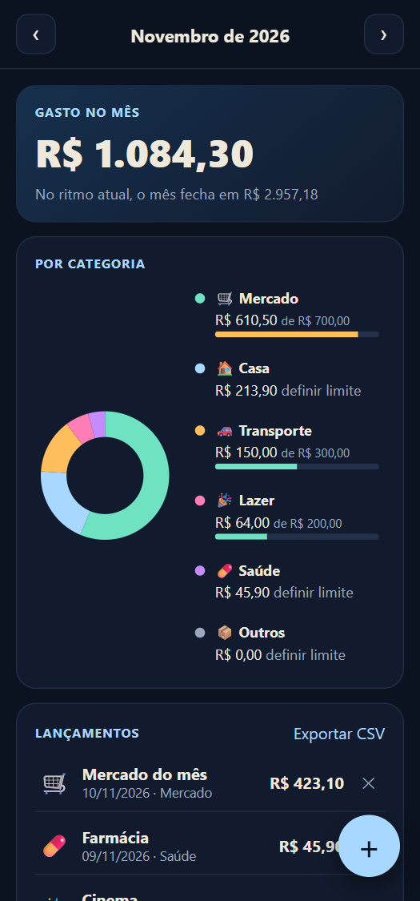

# app-gastos

**[Abrir o app →](https://luizrenatodc.github.io/app-gastos/)**

App de controle de gastos pessoais para celular (PWA). Dá para instalar na tela inicial, funciona **sem internet** e os dados ficam só no aparelho.



## O que faz

- Lança gastos com descrição, valor, categoria e data.
- Mostra o total do mês, um gráfico por categoria e a **projeção de quanto o mês vai fechar** no ritmo atual.
- **Orçamento por categoria**: a barra fica amarela em 80% e vermelha quando estoura.
- Navega entre meses e **exporta CSV** pronto para o Excel em português (separador `;`, BOM UTF-8).

## Como funciona

- HTML, CSS e JavaScript puros, sem framework e sem build.
- As regras ficam em `docs/regras.js` (funções puras), usadas pelo app e pelos testes.
- Dinheiro é guardado em **centavos inteiros**, sem erro de ponto flutuante (`0,1 + 0,2`).
- O `sw.js` guarda os arquivos em cache: depois da primeira visita, abre offline.
- O `localStorage` tem tratamento de erro: no modo privado o app continua funcionando em memória.

## Rodar

```bash
npm test     # testes das regras de negócio
npm start    # serve a pasta docs/ localmente
```

Os gastos de exemplo são fictícios. Licença MIT.
